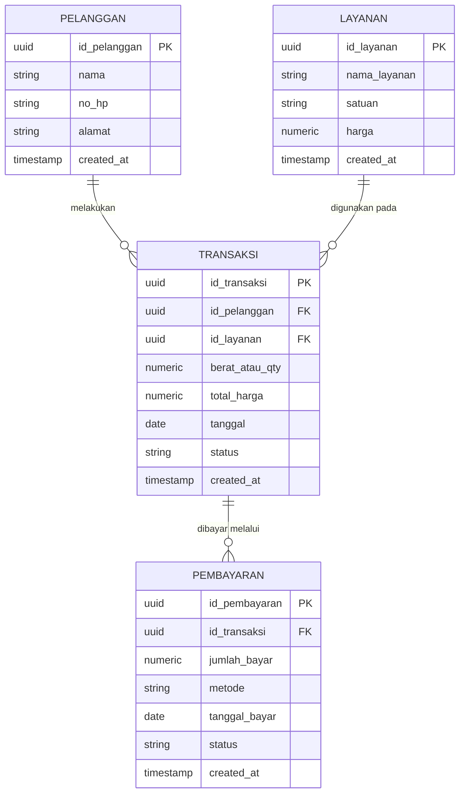

# 🧺 Pure Laundry

### Sistem Akuntansi Laundry Berbasis Web

<p align="center">
  <b>PUTRI BERNETDITA</b><br>
  NIM: 12030124130174<br>
  Mata Kuliah/Kelas: Pengkodean dan Pemrograman / D<br>
  Dosen Pengampu: Dr. Totok Dewayanto, S.E., M.Si., Akt., CA
</p>

<p align="center">
  <b>PROGRAM STUDI S1 AKUNTANSI</b><br>
  <b>FAKULTAS EKONOMIKA DAN BISNIS</b><br>
  <b>UNIVERSITAS DIPONEGORO</b>
</p>

<p align="center">
  🔗 <a href="https://putribernetdita.github.io/App-Pure-Laundry/"><b>▶ KLIK DI SINI UNTUK MEMBUKA SISTEM ◀</b></a>
</p>

---

## 📖 Deskripsi

**Pure Laundry** adalah aplikasi web sistem akuntansi laundry yang mengelola empat entitas utama:

| Entitas | Fungsi |
|---|---|
| 👤 **Pelanggan** | Menyimpan data pelanggan laundry |
| 🧼 **Layanan** | Daftar jenis layanan beserta harga |
| 🧾 **Transaksi** | Pencatatan transaksi laundry pelanggan |
| 💰 **Pembayaran** | Pencatatan pembayaran atas transaksi |

Aplikasi dapat berjalan langsung di browser dengan data contoh, atau terhubung ke **Supabase** sebagai database cloud.

---

## 🗂️ Entity Relationship Diagram (ERD)



### 🔗 Relasi Antar Entitas

| Relasi | Kardinalitas | Keterangan |
|---|---|---|
| Pelanggan → Transaksi | 1 : N | Satu pelanggan dapat melakukan banyak transaksi |
| Layanan → Transaksi | 1 : N | Satu layanan dapat dipakai di banyak transaksi |
| Transaksi → Pembayaran | 1 : N | Satu transaksi dapat memiliki satu atau lebih pembayaran (cicilan) |

---

## 🧱 Struktur Tabel

### 1. `pelanggan`
| Kolom | Tipe | Keterangan |
|---|---|---|
| id_pelanggan | uuid (PK) | Primary key |
| nama | text | Nama pelanggan |
| no_hp | text | Nomor telepon |
| alamat | text | Alamat pelanggan |
| created_at | timestamptz | Waktu data dibuat |

### 2. `layanan`
| Kolom | Tipe | Keterangan |
|---|---|---|
| id_layanan | uuid (PK) | Primary key |
| nama_layanan | text | Contoh: Cuci Kering, Setrika |
| satuan | text | kg / pcs |
| harga | numeric | Harga per satuan |
| created_at | timestamptz | Waktu data dibuat |

### 3. `transaksi`
| Kolom | Tipe | Keterangan |
|---|---|---|
| id_transaksi | uuid (PK) | Primary key |
| id_pelanggan | uuid (FK) | Referensi ke `pelanggan` |
| id_layanan | uuid (FK) | Referensi ke `layanan` |
| berat_atau_qty | numeric | Jumlah berat / kuantitas |
| total_harga | numeric | Total = harga × qty |
| tanggal | date | Tanggal transaksi |
| status | text | proses / selesai / diambil |
| created_at | timestamptz | Waktu data dibuat |

### 4. `pembayaran`
| Kolom | Tipe | Keterangan |
|---|---|---|
| id_pembayaran | uuid (PK) | Primary key |
| id_transaksi | uuid (FK) | Referensi ke `transaksi` |
| jumlah_bayar | numeric | Nominal dibayar |
| metode | text | cash / transfer / qris |
| tanggal_bayar | date | Tanggal pembayaran |
| status | text | lunas / belum lunas |
| created_at | timestamptz | Waktu data dibuat |

> 📄 Dokumentasi lengkap: [`docs/skema-erd-sistem-akuntansi-laundry.md`](docs/skema-erd-sistem-akuntansi-laundry.md)

---

## 🚀 Menjalankan Aplikasi

- **Mode langsung (offline):** buka `frontend/index.html` di browser. Tanpa konfigurasi Supabase, aplikasi berjalan dengan data contoh yang tersimpan di browser.
- **Mode web server opsional:** jalankan `node backend/app.js`, lalu buka `http://localhost:3000`. Tidak ada dependensi npm.
- **Menghubungkan database lokal:** jalankan `database/schema.sql` di Supabase SQL Editor. Di aplikasi, buka ikon pengaturan lalu isi **Project URL** dan **publishable key**.
- **Agar GitHub Pages dan HP memakai project yang sama:** isi `frontend/supabase-config.js` dengan Project URL dan publishable key sebelum push. File ini publik; hanya gunakan publishable key, **bukan** `service_role`.

Konfigurasi dalam `frontend/supabase-config.js` diprioritaskan di setiap perangkat. Pengaturan dari ikon Supabase yang disimpan pada browser hanya menjadi fallback saat konfigurasi bersama belum diisi.

Mode browser langsung dan server lokal sama-sama mengakses Supabase dari frontend. File `backend/app.js` hanya menyajikan frontend dan menyediakan `GET /api/health`; ia tidak menyimpan kredensial database.

> ⚠️ **Keamanan:** skema awal mengizinkan akses CRUD anon agar demo dapat digunakan langsung dengan publishable key. Batasi tabel memakai autentikasi dan policy RLS khusus sebelum memasukkan data laundry sungguhan. **Jangan pernah** memasukkan service role key ke frontend.

---

## 📤 Mengunggah ke GitHub

Pastikan **Git for Windows** sudah terpasang. Buat repository kosong di GitHub, lalu buka terminal pada folder proyek dan ganti URL remote dengan URL repository Anda:

```powershell
git init
git add .
git commit -m "Initial commit"
git branch -M main
git remote add origin https://github.com/USERNAME/NAMA-REPOSITORY.git
git push -u origin main
```

Jika repository lokal sudah memiliki remote `origin`, gunakan:

```powershell
git remote set-url origin https://github.com/USERNAME/NAMA-REPOSITORY.git
```

File `.gitignore` di folder ini mengecualikan file environment lokal, dependensi, hasil build, dan file sistem operasi dari commit.

---

## 🌐 Menerbitkan ke GitHub Pages

Workflow [`.github/workflows/deploy-pages.yml`](.github/workflows/deploy-pages.yml) menerbitkan isi folder `frontend/` sebagai akar situs setiap kali ada push ke branch `main` atau `master`. Dengan begitu, `index.html`, `app.js`, dan `styles.css` berada pada lokasi yang sama dan dapat dimuat dengan path relatif. Jika Pages masih memakai mode branch/root, `index.html` di root repository akan mengarahkan ke `frontend/index.html`.

1. Di repository GitHub, buka **Settings → Pages**.
2. Pada **Build and deployment → Source**, pilih **GitHub Actions**.
3. Push workflow ini ke branch `main` atau `master`, lalu buka tab **Actions** dan tunggu workflow **Deploy Pure Laundry to GitHub Pages** selesai dengan status berhasil.
4. Buka URL Pages yang ditampilkan pada job deployment. Jika masih 404, pastikan workflow berhasil dan URL menggunakan nama owner serta nama repository yang tepat.

GitHub Pages hanya menerbitkan frontend statis. Setelan melalui ikon aplikasi tersimpan per browser; konfigurasi pada `frontend/supabase-config.js` menjadi nilai bersama untuk perangkat baru.

### 🛠️ Jika yang tampil hanya header atau pesan pemuatan

- Pastikan workflow deployment berstatus berhasil. Pada mode **GitHub Actions**, file aplikasi seharusnya tersedia di `<URL-Pages>/app.js` dan `<URL-Pages>/styles.css`.
- Jika memakai mode **Deploy from a branch** dengan isi repository sebagai root, file frontend berada di `<URL-Pages>/frontend/app.js` dan `<URL-Pages>/frontend/styles.css`.
- Buka alamat `app.js` yang sesuai langsung di browser. File harus menampilkan source JavaScript, bukan halaman 404. Jika 404, unggah folder `frontend/` secara lengkap atau gunakan workflow GitHub Actions di atas.
- Pesan fallback aplikasi sekarang menampilkan alamat script atau error JavaScript jika pemuatan gagal. Salin pesan itu untuk mengetahui file yang bermasalah.

---

<p align="center">
  <b>© 2025 PUTRI BERNETDITA — Universitas Diponegoro</b><br>
  <i>Sistem Akuntansi Laundry | Pengkodean dan Pemrograman / D</i>
</p>
